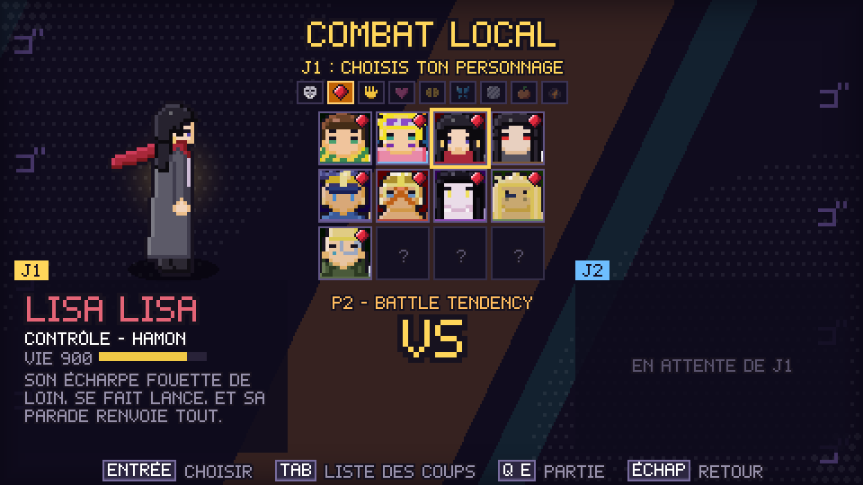
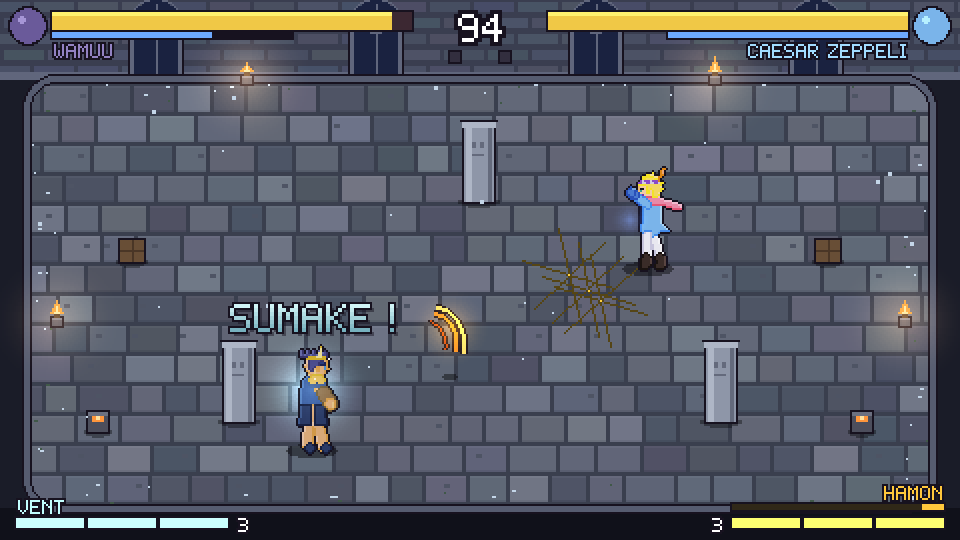

<div align="center">


[](../../actions/workflows/ci.yml)
[](LICENSE)
[](https://www.python.org/)
[](https://pyga.me/)
[](#le-roster)
[](#les-arènes)

### ゴ ゴ ゴ ゴ ゴ

**Un arena fighter 1v1 en temps réel, en pixel art vu de dessus.**
Stands, Hamon, vampires, Hommes du Pilier, arrêt du temps et ultimes en cinématique.
Gratuit, open source, non commercial.


</div>

> **Fan game non officiel.** Ce projet est gratuit, sans but lucratif, et n'est affilié ni à Hirohiko Araki, ni à Shueisha, ni à David Production, ni à CyberConnect2. JoJo's Bizarre Adventure et toutes les marques citées appartiennent à leurs propriétaires respectifs.

---

## Le roster

20 persos jouables sur trois parties (plus deux mannequins d'entraînement), chacun avec ses vraies techniques, ses répliques et son Stand.

| Partie | Persos |
| --- | --- |
| **P1 · Phantom Blood** | Jonathan Joestar · Will A. Zeppeli · DIO Brando · Bruford · Tarkus · Speedwagon |
| **P2 · Battle Tendency** ✅ *complète* | Joseph Joestar · Caesar Zeppeli · Lisa Lisa · Straizo · **Wamuu** · **Esidisi** · **Kars** · **Santana** · Stroheim |
| **P3 · Stardust Crusaders** | Jotaro Kujo · Noriaki Kakyoin · DIO · Jean Pierre Polnareff · **Muhammad Avdol** |

<table>
<tr>
<td width="50%"></td>
<td width="50%"></td>
</tr>
<tr>
<td align="center"><b>Sélection</b> — fiche, Stand, rôle, onglet par partie</td>
<td align="center"><b>Château suisse</b> — le canon à vent de Wamuu</td>
</tr>
</table>

### Les arènes

Le **Caire de nuit** (P3) · le **manoir Joestar en flammes** (P1) · le **château suisse** des Hommes du Pilier (P2).

Dans le manoir et au château, **l'aube se lève** : les rais de soleil tombent sous les fenêtres, s'allongent jusqu'au mur du fond et s'élargissent — 39 % du manoir, 77 % du château, où il ne reste presque plus d'ombre. Un vampire, un zombie ou un Homme du Pilier qui s'y attarde brûle de plus en plus vite, et y laisse le round.

---

## Trois coups, trois façons de se battre

<table>
<tr>
<td width="33%"></td>
<td width="33%"></td>
<td width="33%"></td>
</tr>
<tr>
<td align="center"><b>DIVINE SANDSTORM</b><br>Wamuu fait tourner ses avant-bras, puis <b>deux tornades</b> aspirent et broient</td>
<td align="center"><b>DÉLUGE DE LUMIÈRE</b><br>Kars jette une <b>nappe de neuf lames</b> devant lui</td>
<td align="center"><b>ROAD ROLLER</b><br>Temps arrêté, et le rouleau tombe <b>là où tu te trouves</b></td>
</tr>
</table>

---

## Ce qui rend chaque perso différent

- **Stands** (Jotaro, DIO, Kakyoin, Polnareff, Avdol) : touche Stand, le Stand apparaît et change tous les coups ; un coup sur le Stand blesse son manieur. Hierophant Green se **contrôle à distance** et possède sa cible.
- **Hamon** (Jonathan, Zeppeli, Joseph, Caesar, Lisa Lisa) : respiration qui charge la jauge, coups chargés qui brûlent les morts-vivants. Lisa Lisa a sa **Chaîne d'Onde** d'ASBR : un coup d'ouverture, **trois suites, trois fins** — personne d'autre ne l'a.
- **Vampires et zombies** (DIO, Straizo, Bruford, Tarkus) : jauge de sang, gel, régénération — et le soleil qui les tue.
- **Hommes du Pilier** (Wamuu, Esidisi, Kars, Santana) : un **Mode** (流法) par perso, qui change tout le moveset. Divine Sandstorm fait tourner les avant-bras de Wamuu puis sort **deux tornades** qui aspirent ; les veines d'Esidisi crachent du sang à 500 degrés ; Kars a la plus grande allonge du casting.
- **Éveil** (touche Power Up) : Kars pose le masque de pierre et la Super Aja — **5 secondes immobile et vulnérable**, puis cinématique, et il devient la **forme de vie ultime** : le soleil ne lui fait plus rien et tout son moveset change, sans retour en arrière.
- **Les ultimes ont la forme de leur technique** : le Rift Atmosphérique sort de la **corne** de Wamuu et traverse l'arène, Joseph lance des **câbles** sur toute la largeur, les loupes de Caesar se referment **là où tu te trouves**, le rouleau compresseur de DIO tombe sur ta position.

---

## Jouer

Télécharge `JoJoArena.exe` dans la dernière [Release](../../releases) et lance-le. Rien à installer.

| Touche | Effet |
| --- | --- |
| **F11** / **Alt+Entrée** | plein écran |
| **Échap** (ou Start) | pause — en entraînement, elle contient tous les réglages |
| **Tab** (ou Y) | liste des coups du perso (sélection des persos et pause) |
| **F3** | affiche les zones de frappe |

### Combat

- légère, lourde, spéciale, **enchaînements de trois coups** sur la même touche, dégâts dégressifs sur les longs combos ;
- garde (−80 %), jauge de garde et **Guard Break** ; dash invincible et **Stylish Evade** (esquive au dernier moment, ralenti) ;
- jauge **Heart Heat** à 3 barres : **HHA** (1 barre), **GHA** (2 barres, en cinématique), **Flash Cancel** (½ barre), Pose, Résolution ;
- **clash** : deux attaques se croisent, on martèle pour gagner le duel ; rafale contre rafale, l'écran passe en face-à-face ;
- contres, bonds, coups blindés, casse-garde, tentacule qui attire, grappin visé à la souris ou au stick droit ;
- **objets** : caisses et jarres se ramassent (Pose) et se lancent (Pose) — ou **se balancent** (Lourd). Bruford les attrape **avec ses cheveux** et frappe trois fois plus loin, mais lance moins fort ;
- décor cassable, rebonds sur les murs, recul ;
- onomatopées (ゴゴゴ, ドン, ORA, MUDA…), poses, impacts, et **chaque effet a son propre son**.

### Après le combat

Un **bilan** : dégâts, meilleur combo, plus gros coup, ultimes dépensés et durée, pour chacun des deux.

---

## Mode entraînement

<div align="center">

</div>

La pause (**Échap**) ouvre **Réglages du mannequin** :

| Réglage | Effet |
| --- | --- |
| **Action** | ce que le mannequin répète, choisi parmi les coups de **son** kit (il sort son Stand tout seul), plus dash et pose |
| **Délai** | images d'attente entre deux répétitions, comptées dès qu'il est libre. **0 = riposte à la frame près** : de quoi vérifier si ton coup est vraiment sûr |
| **Enchaîne** | il continue l'enchaînement (ORA, ORA ORA, ORAAA) au lieu de s'arrêter au premier |
| **Se rapproche** | il marche vers toi tant que son coup ne peut pas porter |
| **Entre deux** | il ne fait rien, ou il tient la garde |
| **Enregistrer** | J2 joue le mannequin, **Échap** arrête : la suite est rejouée en boucle |

Et pour regarder un coup à la loupe :

| Touche | Effet |
| --- | --- |
| **F6** | vitesse 100 % → 50 % → 25 % |
| **F7** | gèle le monde |
| **F8** | avance d'exactement **une image** |

La **frise des frames** se lit comme dans les jeux de combat : **jaune** = démarrage, **rouge** = actif, **bleu** = récupération, **violet** = dégâts subis, **gris** = blocage, **vert** = garde, **blanc** = tout est figé (impact, temps arrêté, cinématique). À droite, l'avantage **mesuré** du dernier échange (`J1 TOUCHÉ +6`). En bas, les données du dernier coup de chaque côté : `DIRECT 4/3/10 +6/-2`.

Le réglage du mannequin est **gardé d'une session à l'autre**.

---

## Contrôles

Les touches sont liées à leur **position** sur le clavier : ZQSD en AZERTY correspond à WASD en QWERTY.

| Action | J1 clavier | Manette | Clavier partagé J1 | Clavier partagé J2 |
| --- | --- | --- | --- | --- |
| Déplacement | ZQSD | Stick gauche / croix | ZQSD | Flèches |
| Attaque légère | J | X / Carré | F | 4 (pavé num.) |
| Attaque lourde | K | Y / Triangle | G | 5 |
| Spéciale | L | B / Rond | H | 6 |
| Stand on/off | I | RB / R1 | R | 8 |
| Dash / esquive | Espace | A / Croix | V | 0 |
| Garde (Flash Cancel pendant une attaque) | Maj gauche | LB / L1 | C | 1 |
| Heart Heat : HHA ; direction + Heart Heat : GHA | O | RT / R2 | T | 9 |
| Pose (près d'un objet : le prend, puis le lance) | P | Select / Touchpad | Y | 7 |
| Power Up : **éveil** | U | LT / L2 | B | 3 |

<details>
<summary><b>Les bonnes touches, quel que soit ton matériel</b></summary>

Les touches sont liées à une **position physique**, pas à une lettre : le jeu se joue pareil en AZERTY et en QWERTY, et il **affiche partout le nom imprimé sur ta touche** (`W` devient `Z` en AZERTY). Pareil pour les manettes : le jeu lit le constructeur dans l'identifiant SDL, donc une **DualShock 4 / DualSense affiche CROIX, CARRÉ, OPTIONS** là où une **manette Xbox affiche A, X, MENU, VIEW**.

Deux réglages dans Options si la détection se trompe :

| Réglage | Valeurs |
| --- | --- |
| **Clavier** | `AUTO (QWERTY)` — ce que le système annonce — ou `AZERTY` / `QWERTY` forcé |
| **Manette** | `AUTO (XBOX)` — ce que la manette annonce — ou `XBOX` / `PLAYSTATION` forcé |

Ça ne change **que les noms affichés**. Sous le tableau, le jeu affiche le nom exact des manettes qu'il voit.

Pour changer les touches, modifie `controls.json` dans `%APPDATA%\JoJoArena\` puis relance le jeu. Supprime-le pour revenir aux réglages par défaut.

</details>

<details>
<summary><b>Vibration et barre lumineuse</b></summary>

Les coups se sentent dans les mains : celui qui encaisse prend le poids du coup (moteur lourd), celui qui le place en sent le claquement (moteur léger, plus court). Guard Break, mur, K.O., gel, contre, arrêt du temps et ultimes ont chacun leur vibration. Sur une **DualShock 4 ou une DualSense**, la barre lumineuse prend la couleur du perso qu'on joue. Réglage **Vibration** dans Options, de 0 à 10.

</details>

### Modes

Combat local · Contre l'IA (quatre niveaux) · Arcade (six combats jusqu'à DIO) · Entraînement. Histoire et En ligne sont annoncés dans le menu et arriveront plus tard — la simulation est déjà déterministe, ce qui prépare le rollback.

---

## Développement

Il faut **Python 3.12** ou plus récent, et `pygame-ce`. Rien d'autre : les sprites, les
sons, les icônes et même l'animation de ce README sont générés par le code du dépôt.

| Fichier | Contenu |
| --- | --- |
| [CONTRIBUTING.md](CONTRIBUTING.md) | par où commencer pour contribuer |
| [docs/GDD.md](docs/GDD.md) | le game design, qui fait foi |
| [docs/ROADMAP.md](docs/ROADMAP.md) | ce qui est fait, en cours et à venir |
| [docs/ARCHITECTURE.md](docs/ARCHITECTURE.md) | l'organisation du code |
| [docs/KITS.md](docs/KITS.md) | tous les champs d'un kit de perso |
| [docs/INFRA.md](docs/INFRA.md) | tests, CI, Docker, crochets git, Releases |
| [docs/AGENTS.md](docs/AGENTS.md) | comment le travail se découpe entre agents |
| [CHANGELOG.md](CHANGELOG.md) | ce que chaque version apporte |

<details>
<summary><b>Installer, lancer, tester, construire le .exe</b></summary>

```powershell
python -m venv .venv
.\.venv\Scripts\python.exe -m pip install -e ".[dev]"
```

### Raccourcis avec make

Le `Makefile` regroupe les commandes courantes ; `make` tout seul affiche la liste. Il crée `.venv` et installe tout au premier usage.

| Commande | Effet |
| --- | --- |
| `make run` | lance le jeu (écran titre) |
| `make training P1=dio_p3 P2=kakyoin` | va droit à l'entraînement |
| `make fight`, `make versus`, `make demo` | combat direct, écran VS, ou ordinateur contre ordinateur |
| `make check` | lint puis tests, comme la CI : à lancer avant un commit |
| `make hooks` | une fois : lint et tests rapides automatiques avant chaque commit |
| `make test-fast` | les tests sans ceux qui lancent le jeu entier |
| `make screens` | capture tous les écrans dans `screenshots/tour/` |
| `make sprites`, `make exe`, `make clean` | planches de sprites, `.exe`, nettoyage |
| `make clip` | réenregistre les quatre animations du README dans `docs/media/` |
| `python tools/audit_kits.py` | ce qui se répète d'un perso à l'autre, les ultimes qui ne montrent rien |

Sous Windows il faut un GNU make : `winget install ezwinports.make` ou `choco install make` (ou `mingw32-make`). Les commandes marchent pareil dans PowerShell, cmd ou Git Bash.

### Lancer le jeu

```powershell
.\.venv\Scripts\python.exe -m jojo_arena
```

Options utiles :

| Commande | Effet |
| --- | --- |
| `--demo` | combat joué par l'ordinateur des deux côtés |
| `--scene fight --rounds 1` | va droit au combat, en 1 round gagnant |
| `--scene training --p1 dio_p3 --p2 kakyoin` | va droit à l'entraînement avec ces persos |
| `--scene menu`, `select`, `setup`, `options`, `glossary` | ouvre directement un écran (`--mode training` pour la sélection de l'entraînement) |
| `--p1 jotaro_p3 --p2 mannequin_red` | choisit les persos (avec `--scene fight`, `training`, `setup` ou `--demo`) |
| `--fullscreen` | démarre en plein écran |
| `--lang en` | textes en anglais (`fr` ou `en` ; sinon la langue choisie dans Options) |
| `--frames 300 --screenshot capture.png` | joue 300 images puis enregistre l'image 480 × 270 (tests rapides) |

> Si Python vient du Microsoft Store, Windows range `controls.json` dans `%LOCALAPPDATA%\Packages\PythonSoftwareFoundation.Python.3.xx_...\LocalCache\Roaming\JoJoArena\` quand le jeu tourne depuis les sources. Le `.exe`, lui, utilise bien `%APPDATA%\JoJoArena\`.

### Tests et lint

```powershell
.\.venv\Scripts\pytest.exe
.\.venv\Scripts\ruff.exe check .
.\.venv\Scripts\ruff.exe format --check .
```

GitHub Actions les lance aussi à chaque push (`.github/workflows/ci.yml`).

Les tests couvrent la logique de combat, les menus (parcours au clavier simulé), et lancent chaque écran du jeu dans une fenêtre cachée. Pour voir tous les écrans d'un coup après une modification :

```powershell
.\.venv\Scripts\python.exe tools\screenshot_tour.py
```

Les captures arrivent dans `screenshots/tour/` (ignoré par git).

### Construire le .exe en local

```powershell
.\.venv\Scripts\python.exe tools\build_exe.py
```

Résultat : `dist\JoJoArena.exe`, un seul fichier qui embarque toutes les données.

### Publier une Release

Change la version dans `pyproject.toml` et `jojo_arena/__init__.py`, commit, puis crée et pousse un tag qui commence par `v` :

```powershell
git tag v0.1.0
git push origin v0.1.0
```

GitHub Actions (`.github/workflows/release.yml`) lance les tests, construit le `.exe`, vérifie qu'il démarre, puis publie la Release avec le `.exe` en pièce jointe.

</details>

<details>
<summary><b>L'organisation du code</b></summary>

```text
jojo_arena/
  engine/       moteur générique (boucle, rendu, entrées, géométrie, sprites, police) : zéro référence à JoJo
  combat/       règles génériques (combattant, garde, dash, clash, jauges, rounds) + rules.toml
  characters/   roster.toml, une fiche de jeu par perso, et looks/ (apparence des persos)
  stages/       arènes : données (.toml) et rendu
  ui/           écrans, HUD, menus
  assets/       sprites (et plus tard sons, portraits)
tools/          générateur de sprites (spritegen, make_sprites.py), build du .exe
tests/          pytest
```

Toutes les valeurs d'équilibrage sont dans des fichiers TOML commentés : `combat/rules.toml` (règles globales) et `characters/*.toml` (attaques de chaque perso).

</details>

## Créer ou modifier l'apparence d'un perso

Les sprites sont **générés à partir d'une fiche de données**, sans dessin à la main.

<details>
<summary><b>Toutes les options d'une fiche d'apparence</b></summary>

Les sprites des persos sont **générés à partir d'une fiche de données**, sans dessin à la main. La fiche se trouve dans `jojo_arena/characters/looks/<id>.toml` (voir `jotaro_p3.toml` et `kakyoin.toml`). Elle contient :

- `[build]` : la morphologie, en pixels : taille de la tête (`head_r`), longueur du torse, des jambes et des bras, largeur des épaules, épaisseur des membres… C'est ce qui donne à chaque perso sa silhouette (Jotaro grand et carré, Kakyoin élancé).
- `[palette]` : les couleurs du perso. Une seule couleur suffit, les ombres et les reflets sont calculés.
- `[body]` : la couleur de chaque partie du corps (tête, torse, bras = manches, jambes = pantalon…).
- `[face]` : couleur des yeux, style (`dot`, `tall`, `wide` avec paupière), sourcils, bouche, nez de profil.
- `[[parts]]` : les pièces de costume :
  - `hair` : styles `short`, `long`, `tower`, `spiky`, `swept`, `crest` (crête de casque) ; mèches sur la nuque ; mèche `curl` ondulée ou frange `fringe` ;
  - `cap` : hauteur, bandeau, un ou deux insignes, mèches effilochées sous la casquette ;
  - `headband` : avec une pierre au milieu en option ;
  - `mask` : un visage d'une autre couleur que la tête (casque, visière) ;
  - `coat` : longueur, ouvert ou fermé, évasement, col, épingles de col, boutons, doublure, boutons de manche ;
  - `belt` : une ou deux, rivets, boucle ;
  - `chain` : longueur ;
  - `emblem` : cœur, rond ou losange, sur la poitrine ou les genoux ;
  - `earring` : simple ou en cerise ;
  - `scarf`, `pauldrons` (épaulettes), `gloves` (longs gants, clous, annelés), `loincloth` (pagne) ;
  - `top` (haut ajusté, épaules nues, une bretelle), `boots` (bottes, bouts pointus, annelées) ;
  - `helmet` (casque à pointe en V, tuyau entre les oreilles), `tanks` (bouteilles dans le dos), `cheek_guards` (protections de joues) ;
  - `body_lines` (lignes ondulées sur le corps), `veins` (veines), `tendrils` (filaments qui se déroulent des jambes) ;
  - `sword` : une lame tenue en main, avec garde simple ou en panier.

  `emblem` se place aussi sur les coudes, la ceinture ou sous le menton ; `headband` peut porter une pierre en cœur ; `earring` existe en cœur brisé ; `belt` peut avoir des poches.

Les Stands se font de la même façon (`star_platinum.toml`, `hierophant_green.toml`, `the_world.toml`, `silver_chariot.toml`). Dans `roster.toml`, la clé `stand_sprite` d'un perso indique la planche de son Stand : en combat, quand on appuie sur la touche Stand, il apparaît derrière son manieur et passe devant lui pour frapper.

Un perso qui appelle **plusieurs** compagnons (Speedwagon et sa bande d'Ogre Street) utilise `stand_sprites` à la place : une planche par posture, `stand_sprites = { tattoo = "tattoo/tattoo", amato = "amato/amato" }`. La touche Stand fait défiler les postures (`style = { type = "stance_cycle", ... }`), et c'est le compagnon de la posture en cours qui apparaît.

Après une modification, régénère la planche :

```powershell
.\.venv\Scripts\python.exe tools\make_sprites.py jotaro_p3
```

Le script écrit la planche du jeu dans `jojo_arena/assets/sprites/<id>/`, et des aperçus agrandis dans `build/sprite_previews/` : `<id>.png` pour les 3 vues, `<id>_sheet.png` pour toutes les animations. Pour qu'un nouveau perso apparaisse dans le jeu, ajoute-le aussi dans `jojo_arena/characters/roster.toml`. Un test vérifie que les planches sont à jour par rapport à leur fiche.

### Format d'une planche

Une planche est un PNG en cases carrées (64 × 64 pour les persos générés) accompagné d'un TOML du même nom, qui donne aussi la taille des cases, le point des pieds, et les hauteurs de la poitrine et du haut de la tête (pour placer les effets). Le TOML liste les animations (`idle`, `walk`, `light`, `heavy`, `special`, `dash`, `guard`, `hurt`, `ko`, `pose`). Chaque animation occupe 3 lignes de la planche : vue de face (`down`), de dos (`up`) et de profil vers la droite (`right`). La gauche est le miroir de la droite.

- Une planche dessinée à la main peut remplacer une planche générée, sans changer le code : il suffit de garder les mêmes noms de fichiers.
- Si une planche manque, le jeu affiche une forme simple de la couleur du perso.

</details>

## Licence et mentions

Code sous licence [MIT](LICENSE). Les visuels de ce README sont capturés dans le jeu par
[`tools/record_clip.py`](tools/record_clip.py) (animation PNG écrite sans aucune
bibliothèque, voir [`tools/make_apng.py`](tools/make_apng.py)).

**Fan game non officiel, gratuit et sans but lucratif**, non affilié à Hirohiko Araki,
Shueisha, David Production ou CyberConnect2. JoJo's Bizarre Adventure et toutes les
marques citées appartiennent à leurs propriétaires respectifs.

---

<div align="center">

### ゴ ゴ ゴ ゴ ゴ

*Yare yare daze.*

</div>
