<div align="center">

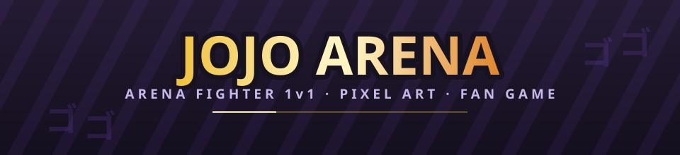

**Un arena fighter 1v1 en temps réel, en pixel art vu de dessus.**

Fan game non officiel de JoJo's Bizarre Adventure — Python 3.12, pygame-ce
19 persos · 3 arènes · simulation déterministe à 60 images par seconde

[](../../actions/workflows/ci.yml)
[](tests/)
[](docs/INFRA.md#couverture)
[](https://www.python.org/)
[](https://pyga.me/)
[](LICENSE)

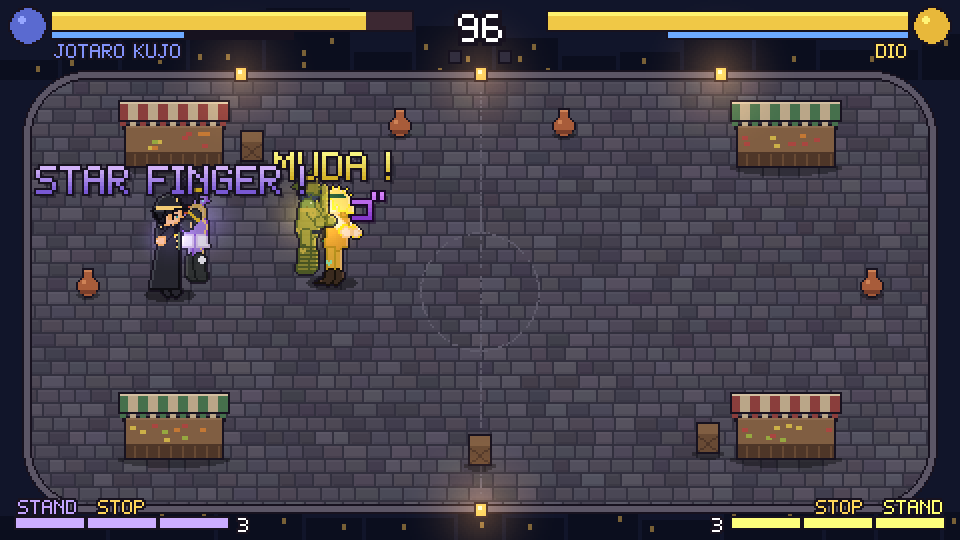

</div>

---

## La question

> **Qu'est-ce qui fait qu'un combat *ressemble* à JoJo, et pas seulement qu'il en porte les noms ?**

Ce n'est pas la taille du roster. C'est que chaque perso **se lise** : qu'on voie à l'écran
d'où vient le coup, pourquoi il porte si loin, et ce qu'on risque en le ratant. Trois familles
cohabitent, et c'est leur confrontation qui fait le jeu :

| | Famille | Ce qui s'y joue |
|---|---|---|
| 👊 | **Stands** | La touche Stand sort le Stand : tout le moveset change, et **un coup sur le Stand blesse son manieur**. Star Platinum est la main la plus rapide (démarrage 4 images), The World la plus lourde. |
| 🌀 | **Onde (Hamon)** | On respire pour charger, on frappe chargé. L'Onde **brûle les morts-vivants** — et elle n'appartient qu'aux vivants : un vampire qui essaierait de la porter se consumerait. |
| 🩸 | **Vampires et Hommes du Pilier** | Jauge de sang, gel, régénération, absorption — et **le soleil qui monte** dans deux arènes, qui les tue s'ils s'y attardent. Kars pose le masque de pierre et n'en a plus rien à faire. |

**L'enjeu technique.** Un jeu de combat se juge sur ce qui se passe entre deux images : un coup
qui démarre en 4 images et laisse +1 en garde interdit à l'adversaire de rejouer, et c'est
invisible à l'œil. Tout ce qui suit est donc **mesuré**, pas ressenti.

---

## Trois coups, trois façons de se battre

<table>
<tr>
<td width="33%">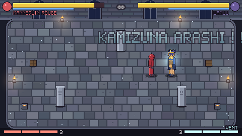</td>
<td width="33%">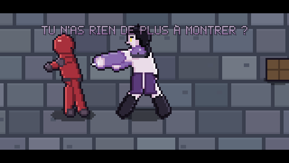</td>
<td width="33%">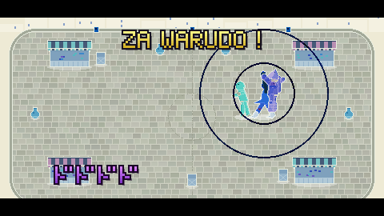</td>
</tr>
<tr>
<td align="center"><b>DIVINE SANDSTORM</b><br><sub>Les avant-bras de Wamuu tournent, puis <b>deux tornades</b> aspirent et broient. Portée 92, aspiration sur 150.</sub></td>
<td align="center"><b>DÉLUGE DE LUMIÈRE</b><br><sub>Kars jette une <b>nappe de neuf lames</b> devant lui, puis la cinématique.</sub></td>
<td align="center"><b>ROAD ROLLER</b><br><sub>Temps arrêté, et le rouleau tombe <b>là où tu te trouves</b>, pas devant DIO.</sub></td>
</tr>
</table>

Un ultime prend la **forme de sa technique** : un rayon est une ligne de 300 px, une explosion
est un rayon de 46, un piège est une large nappe devant soi, une saisie est imparable. Une
hitbox de poing n'est permise que si la technique est un poing — et
[un test le vérifie](tests/test_ultimates.py) sur tout le roster.

---

## La boucle d'un round

<div align="center">
</div>

```
    entrée du joueur  →  Match.step(inputs)  →  liste d'événements  →  la vue réagit
                              ╰── toute la règle est ici, sans pygame
```

La simulation **rapporte**, elle ne dessine pas : `combat/` ne connaît ni l'écran ni le son, et
ne contient **aucune référence à JoJo**. Un coup produit des événements (`hit`, `block`,
`clash`, `cutscene_start`…) que le rendu, les sons, la vibration et la frise des frames lisent
chacun de leur côté. C'est ce qui rend les replays exacts et le rollback possible plus tard.

---

## Ce qui est mesuré

> *Un jeu qui tourne n'est pas un jeu juste.*

<div align="center">
</div>

| Critère | Mesure | Comment |
| --- | --- | --- |
| **Déterminisme** | identique au bit près, **19/19 persos** | mêmes entrées rejouées deux fois : positions, jauges, projectiles et événements comparés ([test](tests/test_determinism.py)) |
| **Données de frames** | **mesuré = annoncé** | la frise mesure l'avantage sur un vrai échange, `framedata` le calcule : les deux doivent tomber pareil ([test](tests/test_framemeter.py)) |
| **Coups positifs en garde** | **0** | un coup léger qui laisse l'avantage en garde verrouille l'adversaire ; refusé pour tout le roster |
| **Coups identiques entre deux persos** | **0** | mêmes images **et** mêmes dégâts = le même perso deux fois (`tools/audit_kits.py`) |
| **Équilibrage** | 24 % à 78 % de victoires | bot contre bot, 100 combats par perso ; [ce que le bot mesure mal](docs/GDD.md) est écrit noir sur blanc |
| **Couverture** | **94 %** sur 13 623 lignes | `combat/` et `characters/` sont la règle du jeu : ils doivent être couverts |

### Un résultat non trivial

Trois mesures successives mettent **Kars en tête (81 %, puis 69 %, puis 78 %)**. L'explication
tentante — « son éveil est trop fort » — est **fausse** : un bot ne reste jamais immobile les
cinq secondes que l'éveil demande, donc la forme ultime n'entre jamais dans ces chiffres. Le
gain vient de son **neutre**, où ses lames de lumière étaient à la fois les plus longues, les
plus rapides et les plus sûres. Une arme longue doit coûter quelque chose quand elle rate : ses
pokes récupèrent plus lentement (−6 et −7 en garde, −19 pour le coup de jambe), et son identité
— la plus grande allonge du casting — est intacte.

---

## Le roster

<div align="center">

| | | | | | |
|:--:|:--:|:--:|:--:|:--:|:--:|
| 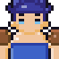<br><sub>Jonathan</sub> | <br><sub>Zeppeli</sub> | 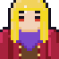<br><sub>DIO</sub> | 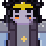<br><sub>Bruford</sub> | 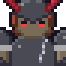<br><sub>Tarkus</sub> | 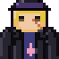<br><sub>Speedwagon</sub> |
| 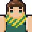<br><sub>Joseph</sub> | 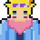<br><sub>Caesar</sub> | 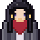<br><sub>Lisa Lisa</sub> | 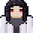<br><sub>Straizo</sub> | 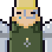<br><sub>Stroheim</sub> | |
| 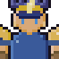<br><sub>Wamuu</sub> | 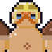<br><sub>Esidisi</sub> | 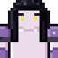<br><sub>Kars</sub> | 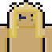<br><sub>Santana</sub> | | |
| 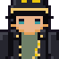<br><sub>Jotaro</sub> | 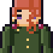<br><sub>Kakyoin</sub> | 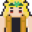<br><sub>DIO</sub> | 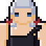<br><sub>Polnareff</sub> | | |

<sub>Partie 1 · Partie 2 (complète) · Partie 3 — les visages sortent du générateur de sprites du jeu.</sub>


</div>

Les notes ci-dessus ne sont pas décidées à la main : elles sont **calculées depuis les kits**
(`tools/make_readme_art.py`), à partir des dégâts, du démarrage, de la portée, de la vie et du
nombre de movesets. Toutes les valeurs d'équilibrage sont dans des TOML commentés, jamais en
dur dans le code.

<table>
<tr>
<td width="50%" valign="top">

### Ce que chacun a en propre
Chaîne d'Onde de Lisa Lisa (une ouverture, **trois suites, trois fins**), cheveux de Bruford qui
portent un objet et frappent à 78, écharpe-lance, régénération de Straizo, masque de pierre de
Kars, arrêt du temps de Jotaro et de DIO, compagnons d'Ogre Street de Speedwagon.

</td>
<td width="50%" valign="top">

### Ce que personne n'a deux fois
Aucun coup n'a les mêmes chiffres chez deux persos. Les seuls noms partagés sont ceux que
l'œuvre partage : Absorption, Zoom Punch, Overdrive, Space Ripper Stingy Eyes.

</td>
</tr>
</table>

---

## Démarrage

### Jouer

Télécharge `JoJoArena.exe` dans la dernière [Release](../../releases) et lance-le. Rien à installer.

### Depuis les sources

```powershell
python -m venv .venv
.\.venv\Scripts\python.exe -m pip install -e ".[dev]"
.\.venv\Scripts\python.exe -m jojo_arena
```

**Dépendances** — Python ≥ 3.12 et **pygame-ce**, rien d'autre : les sprites, les sons, les
icônes et les animations de ce README sont générés par le code du dépôt.

**Temps d'exécution typique** — la suite complète : **≈ 5 min 40** (942 tests). Les tests sans
écran (`make test-fast`) : **≈ 40 s**. Le lint : **≈ 3 s**.

---

## État d'avancement

| Jalon | Contenu | État |
|---|---|---|
| 0 | Moteur, règles, rounds, replays déterministes | ✅ |
| 1 | Partie 3 : Jotaro, Kakyoin, DIO, Polnareff et leurs Stands | ✅ |
| 2 | Partie 1 : Jonathan, Zeppeli, DIO, Bruford, Tarkus, Speedwagon | ✅ complète |
| 3 | Partie 2 : Joseph, Caesar, Lisa Lisa, Straizo, les Hommes du Pilier, Stroheim | ✅ complète |
| 4 | Éveil (Power Up), objets portés et lancés, bilan de fin de combat | ✅ |
| 5 | Altérations d'état (feu, gel, foudre), partie 4 | ⏳ |
| 6 | Mode histoire, arène par partie | ⏳ |
| 7 | En ligne en rollback — la simulation déterministe le prépare | ⏳ |

---

## Mode entraînement

<div align="center">
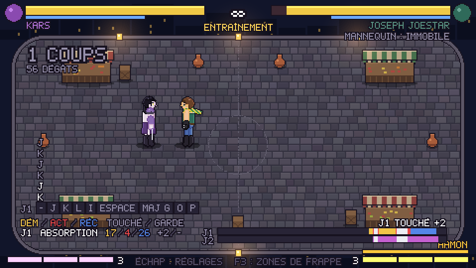
</div>

Le mannequin **répète une action de son propre kit** avec le délai de ton choix, compté dès
qu'il redevient libre — **délai 0 = riposte à la frame près**, de quoi vérifier si un coup est
vraiment sûr. Il peut aussi rejouer une suite que tu lui enregistres.

| Touche | Effet |
| --- | --- |
| **F6** | vitesse 100 % → 50 % → 25 % |
| **F7** | gèle le monde |
| **F8** | avance d'exactement **une image** |
| **F3** | affiche les zones de frappe |

La **frise des frames** : **jaune** = démarrage, **rouge** = actif, **bleu** = récupération,
**violet** = dégâts subis, **gris** = blocage, **vert** = garde, **blanc** = tout est figé. À
droite, l'avantage **mesuré** du dernier échange (`J1 TOUCHÉ +6`). La pause règle aussi la
**durée du temps arrêté** (de 25 % à 200 %), pour travailler un combo dans ZA WARUDO.

---

## Contrôles

Les touches sont liées à leur **position** sur le clavier : ZQSD en AZERTY correspond à WASD en
QWERTY, et le jeu **affiche le nom imprimé sur ta touche**. Une DualShock 4 affiche CROIX et
CARRÉ là où une manette Xbox affiche A et X.

| Action | J1 clavier | Manette | Partagé J1 | Partagé J2 |
| --- | --- | --- | --- | --- |
| Déplacement | ZQSD | Stick gauche | ZQSD | Flèches |
| Légère / Lourde / Spéciale | J K L | X Y B | F G H | 4 5 6 |
| Stand on/off | I | RB | R | 8 |
| Dash / esquive | Espace | A | V | 0 |
| Garde (Flash Cancel en attaque) | Maj gauche | LB | C | 1 |
| Heart Heat (direction + touche : GHA) | O | RT | T | 9 |
| Pose (près d'un objet : le prend, le lance) | P | Select | Y | 7 |
| Power Up : **éveil** | U | LT | B | 3 |

<details>
<summary><b>Détection du clavier et de la manette, vibration, barre lumineuse</b></summary>

Le jeu lit le constructeur dans l'identifiant SDL de la manette. Deux réglages dans Options si
la détection se trompe : **Clavier** (`AUTO`, `AZERTY`, `QWERTY`) et **Manette** (`AUTO`,
`XBOX`, `PLAYSTATION`). Ça ne change **que les noms affichés**.

Les coups se sentent dans les mains : celui qui encaisse prend le poids du coup (moteur lourd),
celui qui le place en sent le claquement (moteur léger, plus court). Guard Break, mur, K.O.,
gel, contre, arrêt du temps et ultimes ont chacun leur vibration. Sur une DualShock 4 ou une
DualSense, la barre lumineuse prend la couleur du perso. Réglage **Vibration** dans Options.

Pour changer les touches : `controls.json` dans `%APPDATA%\JoJoArena\`. Supprime-le pour
revenir aux réglages par défaut.

</details>

---

## Développement

Il faut **Python 3.12** ou plus récent, et `pygame-ce`. Rien d'autre : les sprites, les
sons, les icônes et même l'animation de ce README sont générés par le code du dépôt.

| Fichier | Contenu |
| --- | --- |
| [CONTRIBUTING.md](CONTRIBUTING.md) | par où commencer pour contribuer |
| [docs/GDD.md](docs/GDD.md) | le game design, qui fait foi |
| [docs/ROADMAP.md](docs/ROADMAP.md) | ce qui est fait, en cours et à venir |
| [docs/ARCHITECTURE.md](docs/ARCHITECTURE.md) | l'organisation du code |
| [docs/KITS.md](docs/KITS.md) | tous les champs d'un kit de perso |
| [docs/INFRA.md](docs/INFRA.md) | tests, CI, Docker, crochets git, Releases |
| [docs/AGENTS.md](docs/AGENTS.md) | comment le travail se découpe entre agents |
| [CHANGELOG.md](CHANGELOG.md) | ce que chaque version apporte |

<details>
<summary><b>Installer, lancer, tester, construire le .exe</b></summary>

```powershell
python -m venv .venv
.\.venv\Scripts\python.exe -m pip install -e ".[dev]"
```

### Raccourcis avec make

Le `Makefile` regroupe les commandes courantes ; `make` tout seul affiche la liste. Il crée `.venv` et installe tout au premier usage.

| Commande | Effet |
| --- | --- |
| `make run` | lance le jeu (écran titre) |
| `make training P1=dio_p3 P2=kakyoin` | va droit à l'entraînement |
| `make fight`, `make versus`, `make demo` | combat direct, écran VS, ou ordinateur contre ordinateur |
| `make check` | lint puis tests, comme la CI : à lancer avant un commit |
| `make hooks` | une fois : lint et tests rapides automatiques avant chaque commit |
| `make test-fast` | les tests sans ceux qui lancent le jeu entier |
| `make screens` | capture tous les écrans dans `screenshots/tour/` |
| `make sprites`, `make exe`, `make clean` | planches de sprites, `.exe`, nettoyage |
| `make clip` | réenregistre les quatre animations du README dans `docs/media/` |
| `python tools/audit_kits.py` | ce qui se répète d'un perso à l'autre, les ultimes qui ne montrent rien |

Sous Windows il faut un GNU make : `winget install ezwinports.make` ou `choco install make` (ou `mingw32-make`). Les commandes marchent pareil dans PowerShell, cmd ou Git Bash.

### Lancer le jeu

```powershell
.\.venv\Scripts\python.exe -m jojo_arena
```

Options utiles :

| Commande | Effet |
| --- | --- |
| `--demo` | combat joué par l'ordinateur des deux côtés |
| `--scene fight --rounds 1` | va droit au combat, en 1 round gagnant |
| `--scene training --p1 dio_p3 --p2 kakyoin` | va droit à l'entraînement avec ces persos |
| `--scene menu`, `select`, `setup`, `options`, `glossary` | ouvre directement un écran (`--mode training` pour la sélection de l'entraînement) |
| `--p1 jotaro_p3 --p2 mannequin_red` | choisit les persos (avec `--scene fight`, `training`, `setup` ou `--demo`) |
| `--fullscreen` | démarre en plein écran |
| `--lang en` | textes en anglais (`fr` ou `en` ; sinon la langue choisie dans Options) |
| `--frames 300 --screenshot capture.png` | joue 300 images puis enregistre l'image 480 × 270 (tests rapides) |

> Si Python vient du Microsoft Store, Windows range `controls.json` dans `%LOCALAPPDATA%\Packages\PythonSoftwareFoundation.Python.3.xx_...\LocalCache\Roaming\JoJoArena\` quand le jeu tourne depuis les sources. Le `.exe`, lui, utilise bien `%APPDATA%\JoJoArena\`.

### Tests et lint

```powershell
.\.venv\Scripts\pytest.exe
.\.venv\Scripts\ruff.exe check .
.\.venv\Scripts\ruff.exe format --check .
```

GitHub Actions les lance aussi à chaque push (`.github/workflows/ci.yml`).

Les tests couvrent la logique de combat, les menus (parcours au clavier simulé), et lancent chaque écran du jeu dans une fenêtre cachée. Pour voir tous les écrans d'un coup après une modification :

```powershell
.\.venv\Scripts\python.exe tools\screenshot_tour.py
```

Les captures arrivent dans `screenshots/tour/` (ignoré par git).

### Construire le .exe en local

```powershell
.\.venv\Scripts\python.exe tools\build_exe.py
```

Résultat : `dist\JoJoArena.exe`, un seul fichier qui embarque toutes les données.

### Publier une Release

Change la version dans `pyproject.toml` et `jojo_arena/__init__.py`, commit, puis crée et pousse un tag qui commence par `v` :

```powershell
git tag v0.1.0
git push origin v0.1.0
```

GitHub Actions (`.github/workflows/release.yml`) lance les tests, construit le `.exe`, vérifie qu'il démarre, puis publie la Release avec le `.exe` en pièce jointe.

</details>

<details>
<summary><b>L'organisation du code</b></summary>

```text
jojo_arena/
  engine/       moteur générique (boucle, rendu, entrées, géométrie, sprites, police) : zéro référence à JoJo
  combat/       règles génériques (combattant, garde, dash, clash, jauges, rounds) + rules.toml
  characters/   roster.toml, une fiche de jeu par perso, et looks/ (apparence des persos)
  stages/       arènes : données (.toml) et rendu
  ui/           écrans, HUD, menus
  assets/       sprites (et plus tard sons, portraits)
tools/          générateur de sprites (spritegen, make_sprites.py), build du .exe
tests/          pytest
```

Toutes les valeurs d'équilibrage sont dans des fichiers TOML commentés : `combat/rules.toml` (règles globales) et `characters/*.toml` (attaques de chaque perso).

</details>

## Créer ou modifier l'apparence d'un perso

Les sprites sont **générés à partir d'une fiche de données**, sans dessin à la main.

<details>
<summary><b>Toutes les options d'une fiche d'apparence</b></summary>

Les sprites des persos sont **générés à partir d'une fiche de données**, sans dessin à la main. La fiche se trouve dans `jojo_arena/characters/looks/<id>.toml` (voir `jotaro_p3.toml` et `kakyoin.toml`). Elle contient :

- `[build]` : la morphologie, en pixels : taille de la tête (`head_r`), longueur du torse, des jambes et des bras, largeur des épaules, épaisseur des membres… C'est ce qui donne à chaque perso sa silhouette (Jotaro grand et carré, Kakyoin élancé).
- `[palette]` : les couleurs du perso. Une seule couleur suffit, les ombres et les reflets sont calculés.
- `[body]` : la couleur de chaque partie du corps (tête, torse, bras = manches, jambes = pantalon…).
- `[face]` : couleur des yeux, style (`dot`, `tall`, `wide` avec paupière), sourcils, bouche, nez de profil.
- `[[parts]]` : les pièces de costume :
  - `hair` : styles `short`, `long`, `tower`, `spiky`, `swept`, `crest` (crête de casque) ; mèches sur la nuque ; mèche `curl` ondulée ou frange `fringe` ;
  - `cap` : hauteur, bandeau, un ou deux insignes, mèches effilochées sous la casquette ;
  - `headband` : avec une pierre au milieu en option ;
  - `mask` : un visage d'une autre couleur que la tête (casque, visière) ;
  - `coat` : longueur, ouvert ou fermé, évasement, col, épingles de col, boutons, doublure, boutons de manche ;
  - `belt` : une ou deux, rivets, boucle ;
  - `chain` : longueur ;
  - `emblem` : cœur, rond ou losange, sur la poitrine ou les genoux ;
  - `earring` : simple ou en cerise ;
  - `scarf`, `pauldrons` (épaulettes), `gloves` (longs gants, clous, annelés), `loincloth` (pagne) ;
  - `top` (haut ajusté, épaules nues, une bretelle), `boots` (bottes, bouts pointus, annelées) ;
  - `helmet` (casque à pointe en V, tuyau entre les oreilles), `tanks` (bouteilles dans le dos), `cheek_guards` (protections de joues) ;
  - `body_lines` (lignes ondulées sur le corps), `veins` (veines), `tendrils` (filaments qui se déroulent des jambes) ;
  - `sword` : une lame tenue en main, avec garde simple ou en panier.

  `emblem` se place aussi sur les coudes, la ceinture ou sous le menton ; `headband` peut porter une pierre en cœur ; `earring` existe en cœur brisé ; `belt` peut avoir des poches.

Les Stands se font de la même façon (`star_platinum.toml`, `hierophant_green.toml`, `the_world.toml`, `silver_chariot.toml`). Dans `roster.toml`, la clé `stand_sprite` d'un perso indique la planche de son Stand : en combat, quand on appuie sur la touche Stand, il apparaît derrière son manieur et passe devant lui pour frapper.

Un perso qui appelle **plusieurs** compagnons (Speedwagon et sa bande d'Ogre Street) utilise `stand_sprites` à la place : une planche par posture, `stand_sprites = { tattoo = "tattoo/tattoo", amato = "amato/amato" }`. La touche Stand fait défiler les postures (`style = { type = "stance_cycle", ... }`), et c'est le compagnon de la posture en cours qui apparaît.

Après une modification, régénère la planche :

```powershell
.\.venv\Scripts\python.exe tools\make_sprites.py jotaro_p3
```

Le script écrit la planche du jeu dans `jojo_arena/assets/sprites/<id>/`, et des aperçus agrandis dans `build/sprite_previews/` : `<id>.png` pour les 3 vues, `<id>_sheet.png` pour toutes les animations. Pour qu'un nouveau perso apparaisse dans le jeu, ajoute-le aussi dans `jojo_arena/characters/roster.toml`. Un test vérifie que les planches sont à jour par rapport à leur fiche.

### Format d'une planche

Une planche est un PNG en cases carrées (64 × 64 pour les persos générés) accompagné d'un TOML du même nom, qui donne aussi la taille des cases, le point des pieds, et les hauteurs de la poitrine et du haut de la tête (pour placer les effets). Le TOML liste les animations (`idle`, `walk`, `light`, `heavy`, `special`, `dash`, `guard`, `hurt`, `ko`, `pose`). Chaque animation occupe 3 lignes de la planche : vue de face (`down`), de dos (`up`) et de profil vers la droite (`right`). La gauche est le miroir de la droite.

- Une planche dessinée à la main peut remplacer une planche générée, sans changer le code : il suffit de garder les mêmes noms de fichiers.
- Si une planche manque, le jeu affiche une forme simple de la couleur du perso.

</details>

## Licence et mentions

Code sous licence [MIT](LICENSE).

Tous les visuels de cette page sont **produits par le dépôt**, sans bibliothèque
extérieure : les clips sont enregistrés dans une vraie partie par
[`tools/record_clip.py`](tools/record_clip.py) et écrits en PNG animé par
[`tools/make_apng.py`](tools/make_apng.py) (chunks `acTL`, `fcTL`, `fdAT` à la main) ;
les bannières, compteurs, boucle et fiches de stats sont dessinés en SVG animé (SMIL,
le seul format que GitHub joue dans un README) par
[`tools/make_readme_art.py`](tools/make_readme_art.py), qui lit les kits pour les notes.
`make clip` et `python tools/make_readme_art.py` les régénèrent.

**Fan game non officiel, gratuit et sans but lucratif**, non affilié à Hirohiko Araki,
Shueisha, David Production ou CyberConnect2. JoJo's Bizarre Adventure et toutes les
marques citées appartiennent à leurs propriétaires respectifs.

---

<div align="center">

### ゴ ゴ ゴ ゴ ゴ

*Yare yare daze.*

</div>
